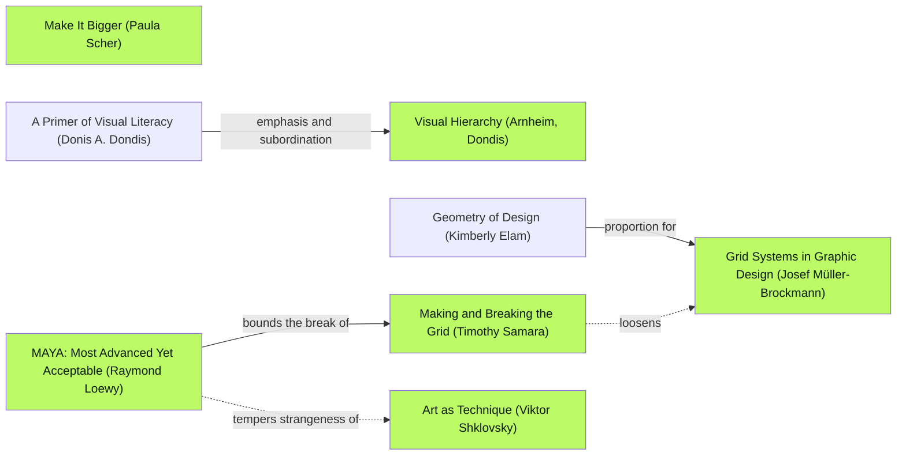
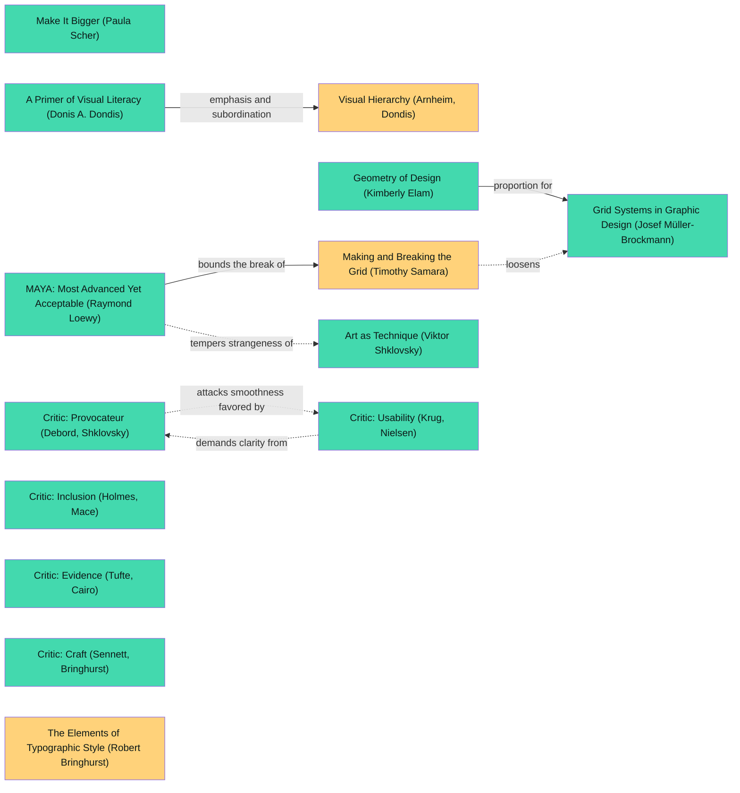

# DADA design log — The Autheo Stack

## Traversal Plan

**Brief:** Explain Autheo's hosting, verification/settlement, agent access and DID-oriented custody vision in one compelling, deployable public webpage without suggesting prototypes are live services.

**Mode:** Adaptive. This serves a public technical audience: the advanced pole must feel like a navigable systems map, while the acceptable pole must make proof boundaries legible to a newcomer.

**Tool inventory:** Inspected the available tool catalog for graph/diagram/workflow tools. Project tracking: OpenClaw `progress_card`. Graph/frontier navigation: source Mermaid edge lines via `rg`; no general-purpose graph renderer or graph query tool was appropriate for this repo. Artifact renderer: SVG embedded in HTML plus headless Chrome screenshot if available. Panel: sequential independent written critics; subagent delegation is not authorized here. Persistence: this log and repository files.

**Seed (exact graph labels):** Stance `Make It Bigger (Paula Scher)`; rules `Visual Hierarchy (Arnheim, Dondis)` and `Grid Systems in Graphic Design (Josef Müller-Brockmann)`; breaker `Making and Breaking the Grid (Timothy Samara)`; adaptive criterion `MAYA: Most Advanced Yet Acceptable (Raymond Loewy)`; dotted counterpoint `Art as Technique (Viktor Shklovsky)`. Path: `A Primer of Visual Literacy (Donis A. Dondis)` —emphasis and subordination→ `Visual Hierarchy (Arnheim, Dondis)`; `Geometry of Design (Kimberly Elam)` —proportion for→ `Grid Systems in Graphic Design (Josef Müller-Brockmann)`; `Making and Breaking the Grid (Timothy Samara)` —loosens (dotted)→ `Grid Systems in Graphic Design (Josef Müller-Brockmann)`; `MAYA: Most Advanced Yet Acceptable (Raymond Loewy)` —tempers strangeness of (dotted)→ `Art as Technique (Viktor Shklovsky)`.

**Initial Frontier:**

| Candidate | Reached via (edge label, direction) | From anchor | Status |
| --- | --- | --- | --- |
| Typography for a singular thesis | emphasis and subordination, incoming | Visual Hierarchy (Arnheim, Dondis) | OPEN |
| Layered architectural grid | proportion for, incoming | Grid Systems in Graphic Design (Josef Müller-Brockmann) | OPEN |
| Break the grid with a route / proof spine | loosens, dotted outgoing | Making and Breaking the Grid (Timothy Samara) | OPEN |
| Accessibility constrains spectacle | tempers strangeness of, dotted outgoing | MAYA: Most Advanced Yet Acceptable (Raymond Loewy) | OPEN |
| Wayfinding for non-experts | dual criterion for, outgoing | MAYA: Most Advanced Yet Acceptable (Raymond Loewy) | OPEN |

**Live graph (Mermaid source selection; `visited` marks seed):**

## Move M1: A diagram that is the page (BREAK)

Depends on: none.
Anchors: Stance `Make It Bigger (Paula Scher)` | Rule `Grid Systems in Graphic Design (Josef Müller-Brockmann)` | Breaker `Making and Breaking the Grid (Timothy Samara)` | Counterpoint `Art as Technique (Viktor Shklovsky)` (dotted edge from `MAYA: Most Advanced Yet Acceptable (Raymond Loewy)`).
Intent: Make the dependency map the hero instead of decorating a list of products; give the stack a directional proof spine running against the card grid.
Formal argument: Scher's environmental scale gives the system presence, Müller-Brockmann supplies orderly layer labels, and Samara's bounded break creates a memorable path through the stack.
Alternatives rejected: a generic gradient SaaS hero obscures relationships; a literal global-network globe repeats cloud clichés and suggests live global nodes.
Consequence: A dense illustration needs an equivalent HTML reading order and a small-screen solution.
Fence: The grid exists to preserve comparability and scanning; the route may cross it but cannot obscure label text or invert the direction of proof.
Frontier effect: opens separate map/HTML equivalence and a proof-versus-payment vocabulary review.
Advanced pole: an expressive, custom vector systems portrait (`Art as Technique (Viktor Shklovsky)`). Acceptable pole: labelled layers and a plain-language flow (`MAYA: Most Advanced Yet Acceptable (Raymond Loewy)`).

## Move M2: A trust boundary in the copy (KEEP-THE-RULE)

Depends on: M1.
Anchors: Stance `Make It Bigger (Paula Scher)` | Rule `Visual Hierarchy (Arnheim, Dondis)` | Breaker `Making and Breaking the Grid (Timothy Samara)` | Counterpoint `Art as Technique (Viktor Shklovsky)` (dotted edge from `MAYA: Most Advanced Yet Acceptable (Raymond Loewy)`).
Intent: Identify each layer's purpose with terse outcome-first language while naming which integrations are reference work, pilot, or planned.
Formal argument: Visual hierarchy prioritizes the user's question “what does this do?”; a restrained source panel grounds the spectacle in inspectable repos.
Alternatives rejected: promise-first slogans imply complete product integration; a documentation dump makes the architecture unreadable.
Consequence: Status qualifications must be visible near the claims, not hidden in the footer.
Fence: Concision must not collapse “proof” into “payment” or sample DID labels into registered identities.
Frontier effect: opens source-linked layer definitions and accessible textual equivalent.
Advanced pole: a concise speculative systems worldview (`Make It Bigger (Paula Scher)`). Acceptable pole: source-linked claims and scope notes (`MAYA: Most Advanced Yet Acceptable (Raymond Loewy)`).

### Panel, M1 + M2, round R1 (artifact examined: `site-1440.png`, `site-390.png` from local headless Chrome)

| Critic | Anchor used | Observed in the work | Verdict | Requested change |
| --- | --- | --- | --- | --- |
| Critic: Provocateur (Debord, Shklovsky) | Art as Technique (Viktor Shklovsky) | The hand-drawn grid and chart bring system dependencies to the foreground instead of a generic globe. | PASS | Retain the single compositional spine. |
| Critic: Inclusion (Holmes, Mace) | Mismatch: How Inclusion Shapes Design (Kat Holmes) | At 390px the SVG is cropped to a thin middle strip; alt text and text equivalent are present, but sighted mobile users cannot follow the map. | OBJECT / ANDON | Provide an actual readable mobile map, not a sliver of the desktop art. |
| Critic: Usability (Krug, Nielsen) | Don't Make Me Think (Steve Krug) | Layer cards and anchors have clear labels; the cropped diagram makes the first visual path confusing on phone. | OBJECT | Reorder the mobile diagram in a labelled vertical sequence. |
| Critic: Evidence (Tufte, Cairo) | How Charts Lie (Alberto Cairo) | “CONCEPTUAL INTEGRATION MAP” and every prototype badge avoid claiming operational telemetry. | PASS | Preserve status labels in mobile equivalent. |
| Critic: Craft (Sennett, Bringhurst) | The Elements of Typographic Style (Robert Bringhurst) | Desktop title, annotation and card densities form a readable scale; at phone size the vector labels become tiny. | OBJECT | Size mobile diagram text independently. |

Statements of meaning: an operational stack, not a feature grid. Artist questions: can the vector diagram remain the desktop signature while mobile uses an equal-status translation? Critic questions: will the same status and directional meaning survive the translation? Opinions permitted after these questions: yes. Andon pulled: yes, by Inclusion. Resolution: ADAPT M1 using the sibling `MAYA: Most Advanced Yet Acceptable (Raymond Loewy)` —bounds the break of→ `Making and Breaking the Grid (Timothy Samara)`. M2 depends on M1; mark M2 REOPENED until the mobile flow is examined.

## Move M3: Responsive translation of the map (KEEP-THE-RULE)

Depends on: M1 ADAPT; M2 REOPENED.
Anchors: Stance `Make It Bigger (Paula Scher)` | Rule `Visual Hierarchy (Arnheim, Dondis)` | Breaker `Making and Breaking the Grid (Timothy Samara)` | Counterpoint `Art as Technique (Viktor Shklovsky)` (dotted edge from `MAYA: Most Advanced Yet Acceptable (Raymond Loewy)`).
Intent: Preserve the diagram's directional hierarchy in a genuine one-column mobile schematic while the original SVG remains fully visible at tablet/desktop widths.
Formal argument: hierarchy is semantic, not pixel-scaling; a compact role-labelled vertical map is an adaptation of the grid, not a smaller unreadable picture.
Alternatives rejected: horizontal scrolling conceals relationships; shrinking the SVG until it fits makes annotations illegible.
Consequence: Duplicate representation requires aligned content and hidden-state testing at both breakpoints.
Fence: The rule broken is literal consistency of the composition across devices; equivalent structure and qualification must remain.
Frontier effect: opens a breakpoint interaction review and revisits M2's claim hierarchy.
Advanced pole: a distinct information design per medium (`Make It Bigger (Paula Scher)`). Acceptable pole: legible mobile labels (`MAYA: Most Advanced Yet Acceptable (Raymond Loewy)`).

### Panel, M3, round R2 (artifact examined: refreshed `site-390.png` and `site-1440.png`)

| Critic | Anchor used | Observed in the work | Verdict | Requested change |
| --- | --- | --- | --- | --- |
| Critic: Provocateur (Debord, Shklovsky) | Art as Technique (Viktor Shklovsky) | A bespoke desktop chart remains instead of dissolving into five ordinary tiles. | PASS | Keep the chart expressive on desktop. |
| Critic: Inclusion (Holmes, Mace) | Mismatch: How Inclusion Shapes Design (Kat Holmes) | Five readable mobile map rows preserve roles and statuses in a vertical flow. | PASS | None. |
| Critic: Usability (Krug, Nielsen) | Don't Make Me Think (Steve Krug) | Mobile now reads from the app and agent down through tooling to the hosting foundation. | PASS | None. |
| Critic: Evidence (Tufte, Cairo) | How Charts Lie (Alberto Cairo) | “Integration vision”, “pilot”, “prototype”, and “local reference” qualify claims on both layouts. | PASS | None. |
| Critic: Craft (Sennett, Bringhurst) | The Elements of Typographic Style (Robert Bringhurst) | Breakpoint switches to 19px titles and 12px supporting labels without horizontal overflow. | PASS | None. |

Statements of meaning: the same system reads in two media. Artist questions: does the strict one-column map still feel authored? Critic questions: is the bounded tension clear at full scale? Opinions permitted: yes; the five node cards are orderly, and the central handoff could become more distinctive. Andon pulled: no. Resolution: M1 ADAPT passes, M2 REOPENED passes without copy changes; advance the ambition push below.

## Move M4: The proof handoff gets a signal (BREAK / AMBITION PUSH)

Depends on: M1 ADAPT, M3.
Anchors: Stance `Make It Bigger (Paula Scher)` | Rule `Grid Systems in Graphic Design (Josef Müller-Brockmann)` | Breaker `Making and Breaking the Grid (Timothy Samara)` | Counterpoint `Art as Technique (Viktor Shklovsky)` (dotted edge from `MAYA: Most Advanced Yet Acceptable (Raymond Loewy)`).
Intent: Amplify the central MCP-to-L1 proof edge with a single fluorescent waypoint, crossing the strictly rectangular architecture rather than adding another panel.
Formal argument: one emphasized crossing calls attention to the question that defines this system—when an action becomes verified—while retaining the diagram's legible grid.
Alternatives rejected: animated global lines suggest live traffic; a glowing blockchain cube overstates the maturity of settlement.
Consequence: the waypoint must remain small enough not to conceal a label, and its meaning cannot be confused with a confirmed transaction.
Fence: The grid organizes ownership of responsibilities; the break marks an intended seam, not a claim that the seam is already operational.
Frontier effect: opens final whole-artifact check on the relationship between the highlight and the explicit conceptual caption.
Advanced pole: an unforgettable proof seam (`Art as Technique (Viktor Shklovsky)`). Acceptable pole: text beside it explicitly says “READS / PROOFS”, not “settled” (`MAYA: Most Advanced Yet Acceptable (Raymond Loewy)`).

### Panel, M4, round R3 (artifact examined: `site-768.png`, `site-320.png`, `site-1440.png`)

| Critic | Anchor used | Observed in the work | Verdict | Requested change |
| --- | --- | --- | --- | --- |
| Critic: Provocateur (Debord, Shklovsky) | Art as Technique (Viktor Shklovsky) | The luminous waypoint makes the transition between MCP and proof visually specific; no fictitious globe is required. | PASS | None. |
| Critic: Inclusion (Holmes, Mace) | Mismatch: How Inclusion Shapes Design (Kat Holmes) | At 768px the full SVG shrinks beyond useful annotation size; 320px exposes one pixel of overflow in a heading. | OBJECT / ANDON | Use the vertical map at tablet widths; fit the heading at 320px. |
| Critic: Usability (Krug, Nielsen) | Don't Make Me Think (Steve Krug) | Dotted and solid arrows are explained by the chart's heading; the small 768px labels are not comfortably scannable. | OBJECT | Move the visual breakpoint earlier. |
| Critic: Evidence (Tufte, Cairo) | How Charts Lie (Alberto Cairo) | The highlight does not contradict “integration vision”; the explanatory caption still names it conceptual. | PASS | None. |
| Critic: Craft (Sennett, Bringhurst) | The Elements of Typographic Style (Robert Bringhurst) | On 320px, the long heading exceeds viewport by one pixel. | OBJECT | Tighten the small-screen title one size. |

Statements of meaning: the seam asks “how does an event become evidence?” Artist questions: what breakpoint preserves both typography and topology? Critic questions: is 768 a tablet or a compact desktop for this illustration? Opinions permitted: yes; here the label size makes it a compact surface. Andon pulled: yes, by Inclusion. Resolution: ADAPT M3 to show the mobile map through 900px; ADAPT M2's heading at 440px and below. M4 depends on the map, so mark M4 REOPENED and re-evaluate it in the WHOLE round on the refreshed render.

## Frontier after R3

All immediate in-, out- and dotted-edge neighbors of the selected seed were considered; source edge labels are retained below. A DEFERRED row is a deliberate exclusion from this small public web artifact, not a claim that the source graph was exhausted globally.

| Candidate(s) | Reached via (edge label / direction) | From anchor | Disposition |
| --- | --- | --- | --- |
| `dondis`, `arnheim` | emphasis and subordination / incoming; basis of / incoming | `vh` | TAKEN M2; DEFERRED extra perception study (no change to rendering) |
| `c_pyr`, `c_inv` | structure analogue / incoming; content analogue / dotted outgoing | `vh` | DEFERRED: prose already uses outcome-first hierarchy; no additional text inversion |
| `itstyle`, `elamGeo`, `lupType` | codifies / outgoing; proportion for / incoming; Letter Text Grid leads to / incoming | `mb` | TAKEN M1 for proportions; DEFERRED separate typography system (static site scale) |
| `c_chest`, `godfrey`, `c_adr`, `crit_formal` | know why the rule exists / incoming; includes / incoming; grid decision recorded for / incoming; judges structure with / incoming | `mb` | TAKEN M1 rationale and log; DEFERRED extended canon review |
| `c_dreyfus`, `c_chest`, `kandCSA`, `c_adr`, `crit_rupt`, `shklovsky` | expert stage breaks / incoming; know why the rule exists / incoming; inner necessity justifies / incoming; rupture recorded for / incoming; breaks the grid with / incoming; making strange for / incoming | `samBreak` | TAKEN M1/M4 for bounded rupture; DEFERRED unrelated expert-stage studies |
| `hitmakers`, `rogers`, `heath`, `c_kano`, `c_zpd`, `c_prog`, `c_pugh`, `c_dbs`, `c_premortem`, `c_jtbd`, `c_four` | popularizes; compatibility and trialability for; stickiness recipe for; basics are access; challenge just beyond reach tunes; approachable surface and ambitious depth; score every concept on both poles; weigh both poles; imagine nobody dares approach; audience job frames welcome; relationship side sets tone / incoming | `maya` | DEFERRED: public audience and two-pole test already documented; no additional positioning experiment |
| `normanE`, `yablonski`, `upd`, `curbcut`, `bierut`, `sideways`, `haraW`, `CRITICS`, `c_strangler`, `argyris` | visceral behavioral reflective levels; Jakob's Law familiarity; aesthetic-usability effect; access as ambition multiplier; wit as welcome; humor as welcome; emptiness as invitation; score both poles; sibling is reached by an existing edge; double loop revises the governing criterion / incoming | `maya` | TAKEN usability/access and panel; DEFERRED alternative framing where no objection remains |
| `c_adr`, `samBreak`, `shklovsky`, `carson` | dual criterion for; bounds the break of; tempers strangeness of / dotted; acceptability limit on / dotted / outgoing | `maya` | TAKEN M3; applied `shklovsky`; deferred Carson as illegible break |
| `kahneman`, `samBreak`, `sideways`, `crit_prov`, `crit_rupt` | making strange counters cognitive ease of / dotted outgoing; making strange for / outgoing; making strange for / outgoing; makes strange with / incoming; makes strange with / incoming | `shklovsky` | TAKEN M1/M4, declining additional cognitive friction |
| `vignelliCanon`, `wheeler` | contrasts with / dotted; identity as environment answers / dotted | `scher` | DEFERRED: site needs a stack language, not an unrelated corporate rebrand |
| Map/HTML equivalence; mobile breakpoint | M1/M3 interaction / local frontier candidate | `mb` + `samBreak` | TAKEN M3; tablet revision after R3 |
| Proof versus settlement vocabulary | M1/M2 interaction / local frontier candidate | `vh` + `maya` | TAKEN M2/M4; qualified in diagram and boundary section |

### Panel, WHOLE, round W1 (artifact examined: refreshed `site-1440.png`, `site-768.png`, `site-390.png`, `site-320.png`)

| Critic | Anchor used | Observed in the work | Verdict | Requested change |
| --- | --- | --- | --- | --- |
| Critic: Provocateur (Debord, Shklovsky) | Art as Technique (Viktor Shklovsky) | Full-scale bespoke chart and fluorescent handoff waypoint carry the argument more strongly than generic cards alone. | PASS | None. |
| Critic: Inclusion (Holmes, Mace) | Mismatch: How Inclusion Shapes Design (Kat Holmes) | 768/390/320 show a readable five-row vertical schematic, SVG has title/desc, and an HTML text equivalent follows the diagram. | PASS | None. |
| Critic: Usability (Krug, Nielsen) | Don't Make Me Think (Steve Krug) | Architecture, source links and trust boundaries are discoverable from the header, diagram and card links. | PASS | None. |
| Critic: Evidence (Tufte, Cairo) | How Charts Lie (Alberto Cairo) | Diagram says conceptual; status badges and lower boundary explicitly prevent treating the pilot as settled or a DID registry. | PASS | None. |
| Critic: Craft (Sennett, Bringhurst) | The Elements of Typographic Style (Robert Bringhurst) | Titles, vector annotations and mobile rows retain their relative reading order at four tested widths without overflow. | PASS | None. |

Statements of meaning: a future integrated architecture represented with its honest current boundaries. Artist questions: does the artwork distract from the citations? Critic questions: can a reader locate each source? Opinions permitted: yes; source links are on every layer. Andon pulled: no. No ADAPT, SCRAP, REOPEN or new OPEN Frontier item. M4 REOPENED passes in this whole review.

### Panel, WHOLE, round W2 (artifact examined: unchanged `site-1440.png`, `site-768.png`, `site-390.png`, `site-320.png`)

| Critic | Anchor used | Observed in the work | Verdict | Requested change |
| --- | --- | --- | --- | --- |
| Critic: Provocateur (Debord, Shklovsky) | Art as Technique (Viktor Shklovsky) | The waypoint is distinctive but labelled “READS / PROOFS,” not a fabricated settlement indicator. | PASS | None. |
| Critic: Inclusion (Holmes, Mace) | The Principles of Universal Design (Ronald Mace et al.) | On narrow screens the SVG is replaced rather than silently cropped; the reading-order links remain available. | PASS | None. |
| Critic: Usability (Krug, Nielsen) | Don't Make Me Think (Steve Krug) | Both visual and textual map resolve to the same five component cards and their source links. | PASS | None. |
| Critic: Evidence (Tufte, Cairo) | How Charts Lie (Alberto Cairo) | A proposed chain rail is visibly described as an integration vision, and proof is not equated to payment. | PASS | None. |
| Critic: Craft (Sennett, Bringhurst) | The Elements of Typographic Style (Robert Bringhurst) | Responsive typography and the diagram's panel rhythm remain intact in refreshed renders. | PASS | None. |

Statements of meaning: technology layers with different authority, not a single all-powerful service. Artist questions: are any decorative signs mistaken for live statistics? Critic questions: do cards contain operational metrics? Opinions permitted: no; the only numeric tags indicate structure, not telemetry. Andon pulled: no. Second consecutive WHOLE round with no ADAPT, SCRAP, REOPEN or new OPEN Frontier item.

## Anchor Ledger

| Anchor | Role | Status | Evidence | Replacement / strongest objection survived |
| --- | --- | --- | --- | --- |
| Make It Bigger (Paula Scher) | Stance | KEEP | Hero-scale thesis and full-page schematic | Survived concern about overstatement with prominent trust boundary |
| Visual Hierarchy (Arnheim, Dondis) | Rule | ADAPT | Two-level headers and separate mobile map | Survived 320px overflow after type reduction |
| A Primer of Visual Literacy (Donis A. Dondis) | Incoming rule | KEEP | Primary headline and subordinate qualification | Survived dense topology objection |
| Grid Systems in Graphic Design (Josef Müller-Brockmann) | Rule | KEEP | Five comparable layer panels | Survived pressure for a decorative unstructured globe |
| Geometry of Design (Kimberly Elam) | Incoming rule | KEEP | Proportional cards and spacing | Survived diagram density objection |
| Making and Breaking the Grid (Timothy Samara) | Breaker | ADAPT | Dotted evidence path crosses card grid | Survived mobile scale objection through layout translation |
| MAYA: Most Advanced Yet Acceptable (Raymond Loewy) | Governing criterion | KEEP | Ambitious graphic; legible status and responsive copy | Survived temptation to sacrifice legibility for illustration |
| Art as Technique (Viktor Shklovsky) | Dotted counterpoint | KEEP | Unfamiliar seam rather than generic cloud illustration | Survived concern that seam implies live chain action |
| Critic: Provocateur (Debord, Shklovsky) | Critic | KEEP | R1–W2 independent judgments | Survived concern about generic SaaS styling |
| Critic: Inclusion (Holmes, Mace) | Critic | KEEP | R1/R3 Andon; responsive correction | Survived accessibility objection at tablet breakpoint |
| Critic: Usability (Krug, Nielsen) | Critic | KEEP | Source links and mobile sequence | Survived initial navigation ambiguity |
| Critic: Evidence (Tufte, Cairo) | Critic | KEEP | Honest status tags | Survived live-metrics interpretation concern |
| Critic: Craft (Sennett, Bringhurst) | Critic | KEEP | 320–1440px typography tests | Survived 320px heading overflow |
| Mismatch: How Inclusion Shapes Design (Kat Holmes) | Access lens | KEEP | Mobile schematic | Survived cropped SVG objection |
| The Principles of Universal Design (Ronald Mace et al.) | Access lens | KEEP | W2 breakpoint audit | Survived breakpoint ambiguity |
| Don't Make Me Think (Steve Krug) | Usability lens | KEEP | Layer links and flow | Survived M1 map interpretation objection |
| How Charts Lie (Alberto Cairo) | Evidence lens | KEEP | “CONCEPTUAL” label in SVG | Survived prototype status ambiguity |
| The Elements of Typographic Style (Robert Bringhurst) | Craft lens | ADAPT | Adjusted 320px heading | Survived 1px overflow |

**Dotted-edge disposition:** `scher` → Vignelli Canon declined (not a rebrand); `scher` → Designing Brand Identity declined (architecture map instead of identity manual); `vh` → Inverted Pyramid Style applied (outcome-first copy); `samBreak` → `mb` applied (cross-grid proof seam); `maya` → `shklovsky` applied (legibility limits rupture); `maya` → The End of Print declined (distorted typography would impede reading); `shklovsky` → Thinking, Fast and Slow declined (no extra cognitive friction); `crit_prov` → `crit_use` and reverse applied (mutual readability challenge in R1–W2); `crit_evid` → Critic: Wit declined (no comedic framing for operational proof). No other dotted edge leaves a named/used anchor in the selected source graph.

**Live graph after W2:** Mark `scher`, `mb`, `maya`, `shklovsky`, `crit_prov`, `crit_inc`, `crit_use`, `crit_evid`, `crit_craft` and associated incoming/lens anchors KEPT; mark `vh`, `samBreak`, `bring` ADAPTED. Mermaid overlay:

## Stop test and double loop

- S1 met: no OPEN candidate; all local and one-hop Frontier entries are TAKEN or explicitly DEFERRED above.
- S2 met: W2 returns five PASS decisions, no Andon.
- S3 met: consecutive W1 and W2 make no ADAPT, SCRAP, REOPEN or OPEN item.
- S4 met: M4 deliberately pushes the handoff with a fluorescent waypoint, then W1/W2 re-evaluate it.
- S5 met: every dotted outgoing edge from the active anchors is dispositioned above.

**Graph amendments (double loop):** The criterion itself held; the graph initially did not represent responsive semantic translation. Add a local node “Diagram-to-text equivalence across breakpoints” with a solid edge to Visual Hierarchy, rather than treating mobile as a mechanically shrunk version of the same grid. The mobile Andon revealed the omission without needing to relax the dual-pole criterion.

## Compliance Check

- [x] Tooling inventory and tools used: Traversal Plan; `progress_card`, `rg`, repository Mermaid, local Chrome renderer, this log; no graph query tool used.
- [x] Mode and reason: Traversal Plan, Adaptive for a public audience.
- [x] Exact seed, dotted counterpoint and living Frontier: Traversal Plan and Frontier after R3.
- [x] BREAK move taken with no move quota: M1 and M4; closure based solely on S1–S5.
- [x] Pre-move Decision Records including dependency, formal argument, two alternatives, fence and two poles: M1–M4.
- [x] Valid panel per round, observable evidence and cited anchors: R1, R2, R3, W1, W2.
- [x] Andon / OBJECT resolutions and reopened dependencies: R1 and R3; M2/M4 revisited.
- [x] WHOLE rounds and stop test: W1, W2 and S1–S5 above.
- [x] Anchor Ledger and updated Mermaid graph: preceding sections.
- [x] Double-loop paragraph: Graph amendments above.
- [x] Final response must state Adaptive mode, `rg`/Mermaid/Chrome/progress-card tooling, S1–S5 met and any skipped steps; screenshots are local artifacts not committed.
